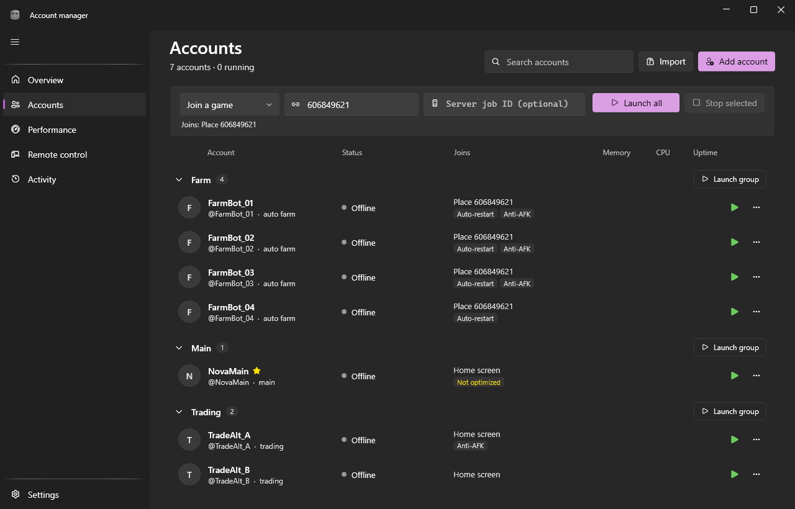

# Account manager

A Windows app for running several Roblox accounts at once without your PC grinding to a halt.



## What it does

- **Accounts in one place.** Sign in through a built-in browser or import saved session cookies. Each account keeps its own name, tags, notes and default game.
- **Launch many clients side by side.** Join a game by place ID, link, private server or a specific server's job ID, or follow another player into their game. Launches are spaced out and pause while RAM is low.
- **Keep clients light.** FPS cap (down to 5), per-client CPU and memory limits, efficiency mode, low priority, auto-mute, a low-graphics preset, and regular memory trimming.
- **Keep them running.** Auto-restart after crashes or disconnects, with backoff, and anti-AFK so idle clients aren't kicked.
- **Check in from elsewhere.** An optional web panel for your phone, protected by a token, plus Discord notifications when a client crashes.

## Download

Get `AccountManager.exe` from the [latest release](https://github.com/S4US/account-manager/releases/latest) and run it. The app checks for new versions and asks before installing one.

## Requirements

- Windows 10 or 11
- [.NET 8 Desktop Runtime](https://dotnet.microsoft.com/download/dotnet/8.0)
- Microsoft Edge WebView2 Runtime (already part of Windows 11)
- Roblox installed and started at least once

## Build

```
dotnet build
dotnet test
dotnet publish src/AccountManager.App -c Release -r win-x64 -o publish/win-x64
```

The last command produces a single `AccountManager.exe`.

To publish a release, push a version tag (for example `git tag v0.2.0` then `git push origin v0.2.0`). GitHub Actions builds and tests it and attaches the exe, its SHA-256 checksum and a zip to a new release. Installed copies pick it up through the updater.

## Your data

- Everything is stored in `%APPDATA%\AccountManager`: accounts, settings and logs.
- Saved sign-ins are encrypted so only your Windows account can read them. An optional master password adds a second lock.
- The app talks to roblox.com, a Discord webhook if you set one up, and GitHub to check for updates (you can turn that off in Settings). Nothing else is sent anywhere.
- While managed clients run, the app writes Roblox's frame rate setting and fast-flag file. Your own values are put back afterwards.

## Note

Running several Roblox clients at once may go against Roblox's Terms of Use. Use it at your own risk. This project is not affiliated with Roblox.

## License

[MIT](LICENSE)
